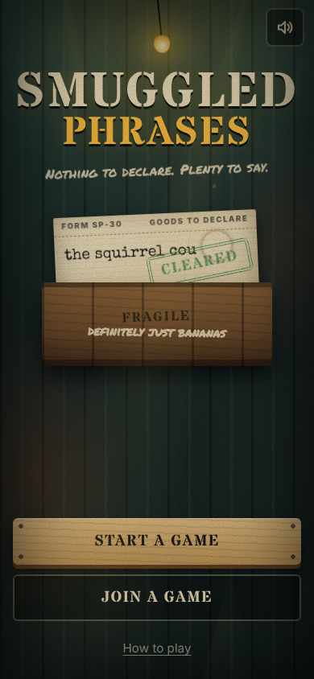
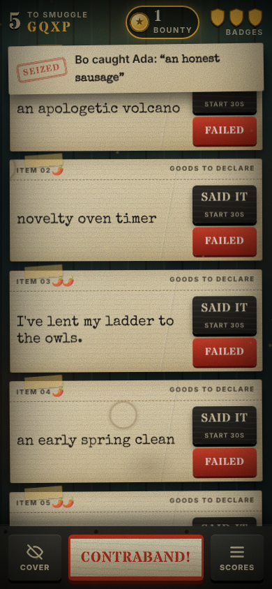
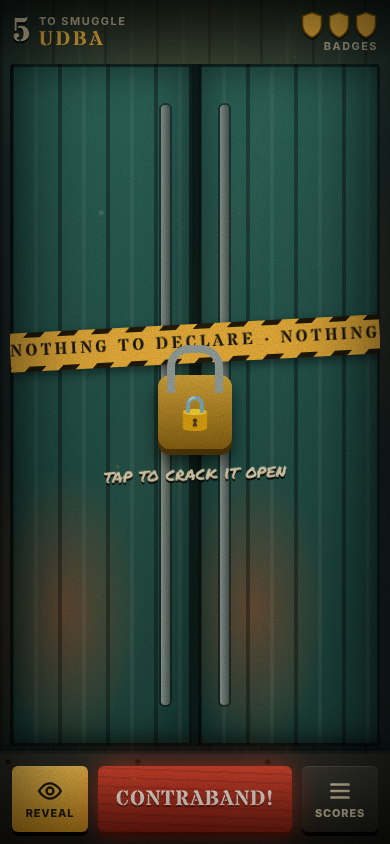
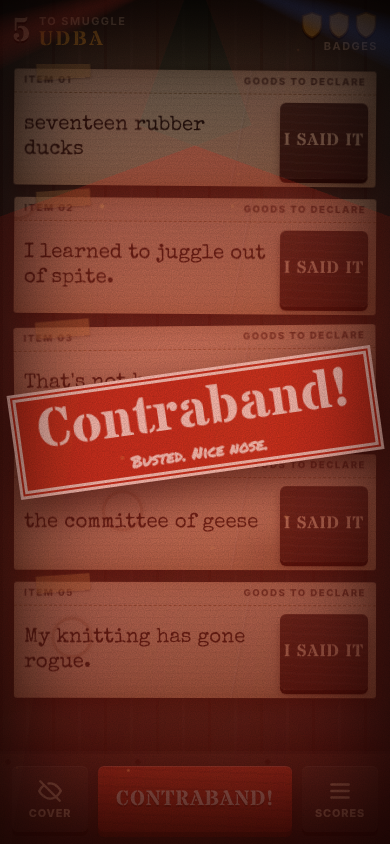
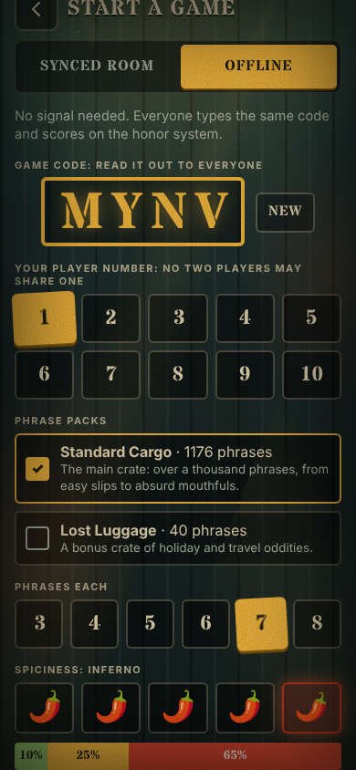

# Smuggled Phrases

> Nothing to declare. Plenty to say.

An in-person party game, as an installable PWA. Every phone privately holds a hand of silly
phrases. Work one into the real conversation without anyone noticing and you have smuggled it.
The app only manages hands, timers and scoring; all of the play happens out loud.

| | | | |
| --- | --- | --- | --- |
|  |  |  |  |

## How to play

1. Everyone starts with **5 secret phrases** (the host can choose 3 to 8, and how spicy they are).
2. Say a phrase out loud in conversation, then tap **I said it** on that card. A private 30-second countdown starts.
3. If nobody calls it in 30 seconds, shout **"Smuggled!"**, show the card and stamp it out of your hand.
4. To catch someone, shout **"Contraband!"** inside the 30 seconds **and repeat the phrase**. Pointing at a person is not enough.
5. Caught: the phrase is seized and replaced. The catcher may swap one of their own phrases for a new one.
6. Wrong call: the caller draws an extra phrase and loses one of their 3 inspector badges. No badges, no calling. Bluffing with odd sentences to drain badges is allowed.
7. First player with an empty hand wins.
8. Phrases must be spoken aloud. Close paraphrases of long phrases count.

## Game settings

The host of a room (or everyone, in an offline game) chooses three things:

- **Phrase packs.** The main crate has 1,176 phrases; the bonus travel crate adds 40.
- **Phrases each.** 3 to 8 to start with. Fewer is a quick round, more is a long con.
- **Spiciness.** Every phrase is rated easy, medium or hard to slip into conversation, shown as
  one to three chillies on the card. A level is never one difficulty: it sets the blend.

| Spiciness | Easy | Medium | Hard |
| --- | --- | --- | --- |
| 1 Mild | 65% | 25% | 10% |
| 2 Medium (default) | 50% | 35% | 15% |
| 3 Hot | 30% | 40% | 30% |
| 4 Extra hot | 15% | 35% | 50% |
| 5 Inferno | 10% | 25% | 65% |

The draw pile is woven to those percentages evenly from top to bottom (and never puts three of
the same difficulty in a row), so every starting hand is a mix, even a hand of three, and the
replacement and penalty draws keep to the same blend. In a synced room the host can change all of
this in the lobby. The table lives in `SPICE_LEVELS` in `src/shared/settings.ts`.



## Accounts and progress

Signing in is optional and has no password. A player types their email and gets a message with a
sign-in link and a 6-digit code; either one works once, for 15 minutes. (The code is there because
on an iPhone the link opens in Safari, not in the installed app.) Signed-in players get:

- **A record kept on the server:** phrases smuggled and seized, smugglers caught, wrong calls,
  clean getaways and games finished, with a rank that follows them to any phone.
- **Counting done by the server.** In a synced room the room itself adds to each signed-in
  player's record as things happen, so it cannot be faked from a phone. Offline games are reported
  by the phone afterwards (queued until there is a connection, capped and de-duplicated), so that
  part is on the honor system like the rest of offline play.
- **Their alias remembered** and prefilled when they join.

Guests still get the same record, kept on the phone only; it moves onto the account the first time
they sign in. Anyone can change their name after joining, from the lobby or the scoreboard, and
everyone is told. The rules pop up once, the first time a game is dealt on a phone.

## Two ways to play

**Offline (no network at all).** One player makes a 4-letter code; everyone types it in and picks a
unique player number (1-10). Each phone shuffles the same deck with a PRNG seeded from the code and
takes only its own stripe of it, so no two phones ever hold the same phrase and replacement draws
never collide. Scoring is on the honor system. A 3-digit "manifest check" number lets the table
confirm everyone typed the same code and picked the same packs and settings. Each difficulty
tier is striped separately before a phone mixes its own pile, so hands stay collision-free even
if someone picks the wrong spiciness.

**Synced rooms (online).** The host opens a room; others join by code, link or QR. The server owns
the deck and every draw. You get a live scoreboard, a **Contraband!** button that names the accused
(who confirms which phrase was caught, or denies), automatic bust / swap / wrong-call handling, and
a win announcement on every phone with the winner's smuggled phrases revealed. The accused's clock
stops while a call is being settled.

In both modes the game survives a locked phone or a reload: timers are stored as start timestamps,
state is persisted locally, and synced phones reconnect on their own.

## Stack

| Part | Choice |
| --- | --- |
| App | Vite, TypeScript, Preact; fonts bundled, no runtime network dependencies |
| Effects | Phaser 3 as a transparent canvas over the UI (searchlights, fog, stamp dust, fuse sparks, alarm lights, cash rain); Web Audio for synthesized sound |
| PWA | Web app manifest plus a small hand-written service worker that precaches every built file |
| Rules | Pure TypeScript module shared by the app and the server |
| Realtime | One Cloudflare Worker; one Durable Object per room, hibernating WebSockets |
| Accounts | One Durable Object per email address; sign-in email sent through the Resend API |
| Tests | Vitest |

```
src/
  packs/            phrase decks (JSON)            <- core.json is the 1,176 phrase deck
  shared/           pure game logic, no DOM, no network
    rules.ts        the rules engine (reducer: game + action -> game + events)
    deal.ts         seeded shuffle and per-player stripes for offline mode
    settings.ts     hand size, spiciness levels and the difficulty mixing
    prng.ts         hash, mulberry32, shuffle, game codes
    packs.ts        pack registry and deck building
    room.ts         synced room logic: members, host, messages -> rules actions, per-player views
    account.ts      sign-in state machine (link, code, sessions, rate limits) and the lifetime record
    protocol.ts     WebSocket message types
  client/           the PWA
    session.ts      OfflineSession (local engine) and SyncSession (socket, reconnects)
    hand.tsx        hand, countdowns, cover, call / swap / accused flows
    fx.ts           Phaser effects layer, lazy-loaded; every call is a no-op until it is ready
    sfx.ts          synthesized sound effects and the mute setting
    flavor.ts       aliases, quips, ranks and the lifetime rap sheet
    screens.tsx     start, setup, lobby, scoreboard, win, how-to
    sw.js           service worker template (file list injected at build)
worker/index.ts     Worker entry, account API routes and the RoomObject Durable Object
worker/accounts.ts  AccountObject Durable Object: hashing, storage, awards from rooms
worker/mail.ts      the sign-in email
tests/              rules, seeded deal, packs, room logic
```

## Local development

Requires Node 20+.

```sh
npm install
npm test            # rules engine, seeded deal, packs, room logic, accounts
npm run dev         # app on http://localhost:5173 (offline mode works on its own)
npm run dev:worker  # in a second terminal: rooms on :8787, proxied from /api by Vite
```

To try the real thing, service worker included, on one port:

```sh
npm run preview     # builds, then serves app + rooms from the local Worker on :8787
```

Local runs start the Worker with `DEV_MAGIC_LINKS=true`: no email is sent, and the sign-in screen
shows the code and link instead. Never set that variable on a deployed Worker.

The service worker is only registered in production builds, so `npm run dev` never serves stale
files. To test on phones over your LAN, note that installing a PWA and service workers need HTTPS
(or localhost); a tunnel such as `cloudflared tunnel --url http://localhost:8787` is the easy way.

## Deployment

Everything deploys as a single Cloudflare Worker: static assets plus the room Durable Object.
It runs on the Workers free plan (the Durable Object uses the SQLite storage backend).

```sh
npx wrangler login
npm run deploy      # vite build, then wrangler deploy
```

### Turning on email sign-in

The game deploys and plays without this; only the sign-in screen needs it. Sign-in email goes
through [Resend](https://resend.com) (free tier is plenty): add and verify your sending domain
there, create an API key, then:

```sh
npx wrangler secret put RESEND_API_KEY        # paste the key when asked
```

and add the sender (and, if you use a custom domain, the public address) to `wrangler.jsonc`:

```jsonc
"vars": {
  "MAIL_FROM": "Smuggled Phrases <login@yourdomain.com>",
  "APP_ORIGIN": "https://play.yourdomain.com"
}
```

`APP_ORIGIN` is the address put in sign-in links; without it the Worker uses the address the
request arrived on. To use a different email provider, change the one `fetch` in `worker/mail.ts`.

Security notes: link tokens, codes and sessions are stored only as SHA-256 hashes; a code locks
after 5 wrong tries; each address gets at most one email every 45 seconds and 6 an hour; sessions
last 180 days and are revoked by signing out. There is no per-IP rate limit, so if the sign-in
endpoint is abused add a Cloudflare rate limiting rule on `/api/auth/request`.

`wrangler.jsonc` holds the config: assets from `dist/`, the `ROOMS` and `ACCOUNTS` Durable Object bindings and their
migrations. Add a `routes` entry or a custom domain in the Cloudflare dashboard if you want one.

If you host the static app somewhere else, build with `VITE_API_BASE=https://your-worker.example`
so the app knows where the rooms live. Offline mode needs no backend at all: any static host works.

## Adding phrase packs

A pack is a JSON file in `src/packs/`:

```json
{
  "id": "after-dark",
  "name": "After Dark",
  "description": "Not for the family table.",
  "rating": "adult",
  "version": 1,
  "phrases": {
    "easy": ["short, nearly normal things", "..."],
    "medium": ["odd noun phrases and short absurd sentences", "..."],
    "hard": ["Long, specific sentences that are hard to say with a straight face.", "..."]
  }
}
```

A pack works best with a healthy number of phrases in every tier, since each spiciness level draws
from all three.

Register it in `PACKS` in `src/shared/packs.ts` and it appears in the host's pack picker in both
modes (`"rating": "adult"` is labelled 18+). Bump `version` whenever you edit a pack, so offline
shuffles never mix old and new contents. `buildDeck()` also accepts unregistered packs, which is
the hook for user-made custom packs later. The pack tests check for duplicates across packs.

## Look, feel and noise

The app is dressed as the inside of a shipping container at night: stained paperwork taped to
steel, a swinging lamp, hazard tape, crate-plank buttons. The cards and controls are ordinary
page elements, so text stays sharp and screen readers still work; Phaser only draws on a canvas
laid over the top and never receives input.

- Phaser is a separate chunk loaded after the app is interactive, capped at 30 fps, and precached
  by the service worker so the effects also work offline.
- With "reduce motion" switched on in the phone's settings, Phaser is never loaded and all CSS
  animation is turned off. The game plays exactly the same.
- Sounds are generated in the browser (no audio files). Nothing makes a noise while a countdown is
  secretly running; the stamp, the "Contraband!" siren and the win fanfare do. The speaker button
  on the start screen and in the scoreboard mutes everything.
- The start screen keeps a lifetime "rap sheet" for this phone (phrases smuggled, seized, clean
  getaways) with a rank that climbs from Tourist to Legend of the Docks.

## Good to know

- **Vibration** fires when a countdown completes where the browser supports it (Android). iOS Safari
  has no vibration API, so there the card turns green instead. The screen is kept awake while a
  countdown runs (where Wake Lock is supported); if the phone was locked anyway, the buzz comes
  when you unlock it.
- **Offline mode** supports up to 10 players and gives each about 117 phrases from the main crate. Player numbers must
  be unique; the app cannot check that without a network.
- **Synced rooms** hold up to 12 players and close after 6 hours without activity. Players are a
  display name plus a random per-device id; signing in is optional. Late arrivals are dealt in.
  The host can void a stuck call or remove a player whose phone has gone away, and if the host
  leaves, the next player becomes host.
- **Regenerating icons**: edit `public/icons/icon.svg`, then `npm run icons` (needs Playwright).
